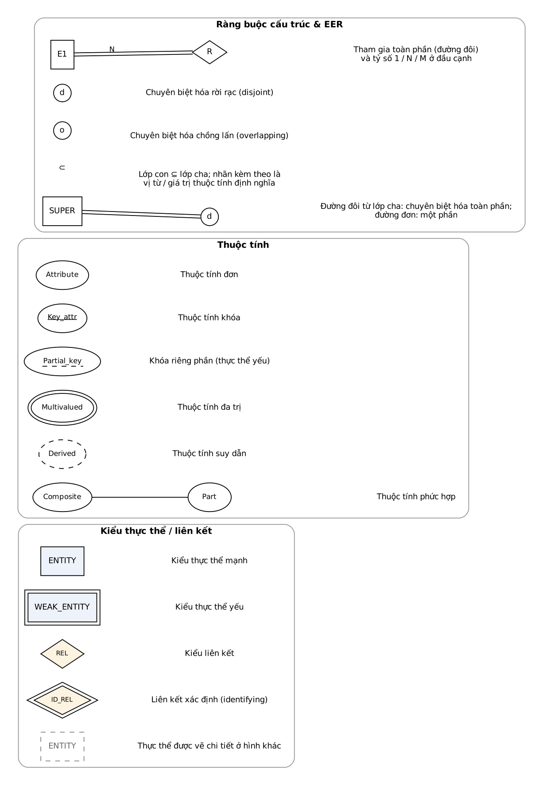
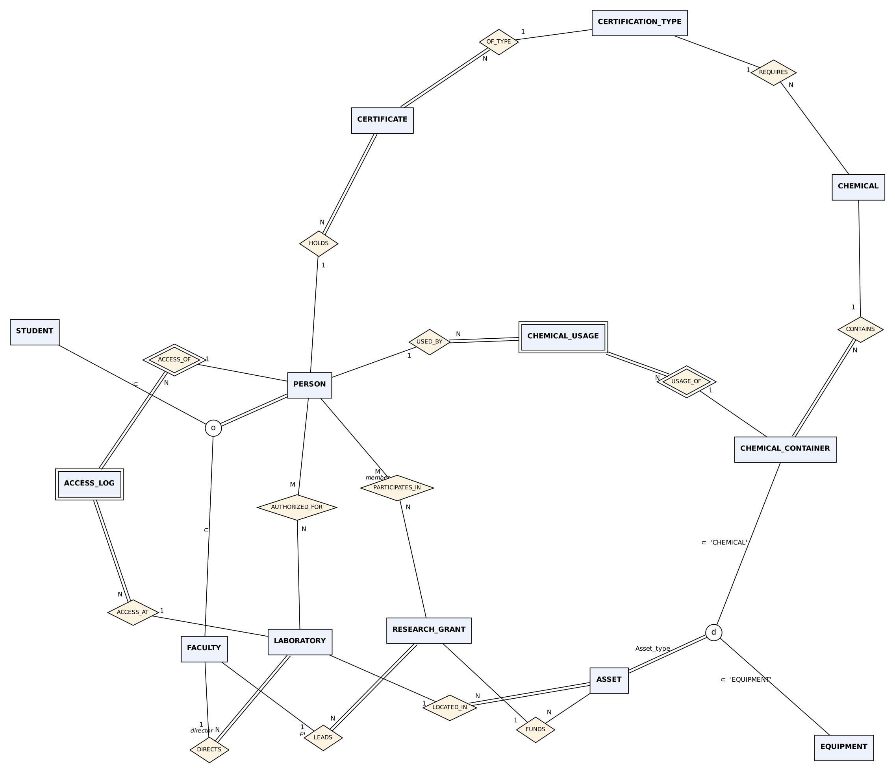
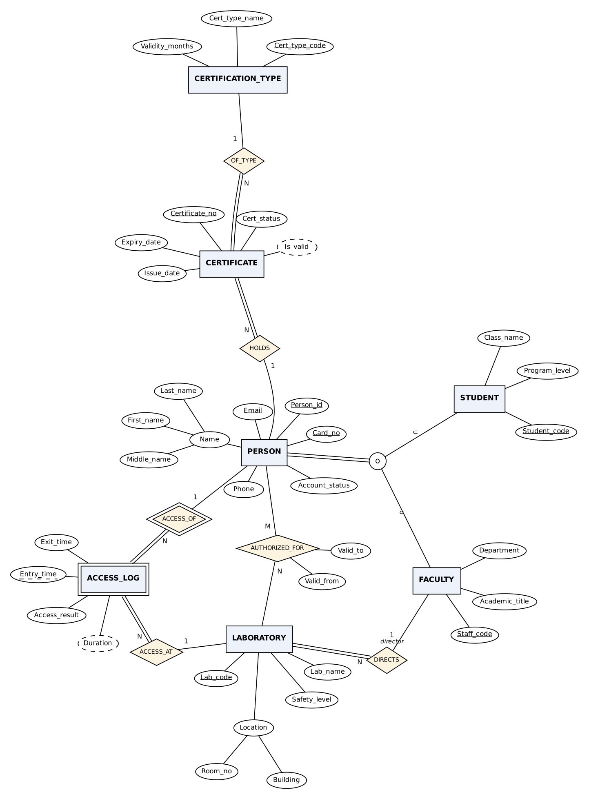
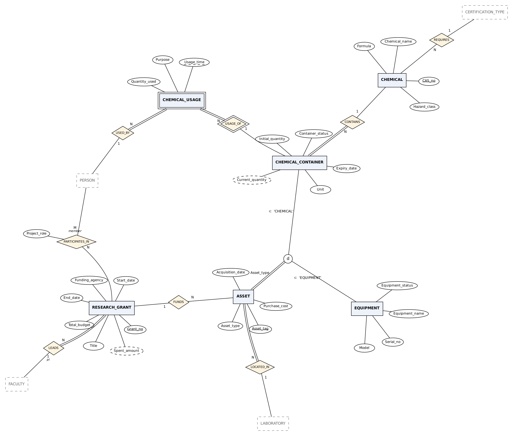
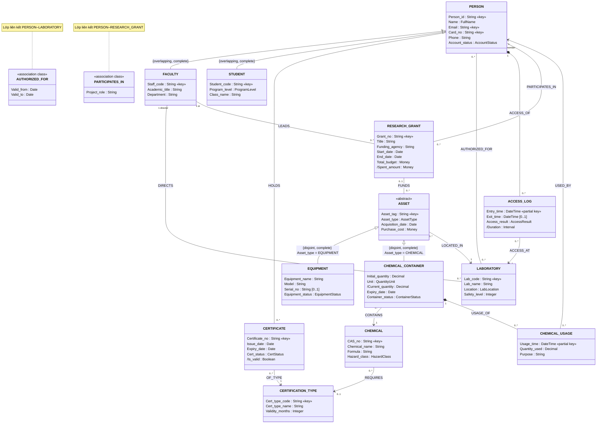
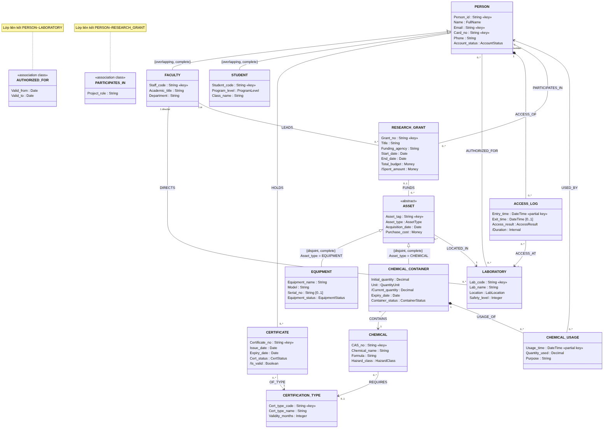

## 2. Thiết kế CSDL (Database Design)

**Quy trình.** Thiết kế CSDL theo các pha của Elmasri & Navathe (2016, tr. 61–62, Hình 3.1) và BG2 (slide 4), ánh xạ vào kế hoạch đồ án:

| Pha (Elmasri) | Sản phẩm | Giai đoạn đồ án | Mục báo cáo |
|---|---|---|---|
| Thu thập & phân tích yêu cầu | Yêu cầu dữ liệu, yêu cầu chức năng, quy tắc nghiệp vụ | GĐ1 (tuần 3–4) | 1, 1.1, 1.2 |
| Thiết kế khái niệm | Lược đồ khái niệm EER (độc lập DBMS) | GĐ1 (tuần 3–4) | **2.1** |
| Thiết kế logic (ánh xạ mô hình dữ liệu) | Lược đồ quan hệ, khóa ngoại, chuẩn hóa | GĐ2 (tuần 5–8) | 2.2, 2.3, 3 |
| Thiết kế vật lý & cài đặt | DDL, chỉ mục, trigger, view, truy vấn | GĐ3 (tuần 9–10) | 4, 5 |

Lược đồ khái niệm mô tả súc tích yêu cầu dữ liệu gồm kiểu thực thể, kiểu liên kết và ràng buộc; vì không chứa chi tiết cài đặt nên dễ dùng để trao đổi với người dùng và để kiểm tra rằng mọi yêu cầu đều được đáp ứng, không mâu thuẫn (Elmasri & Navathe, 2016, tr. 62).

**Ký pháp.** Tài liệu *Industrial Documentation Standards and Frameworks* yêu cầu dùng ký pháp chuẩn công nghiệp – **UML Class Diagram (ISO/IEC 19505)** hoặc **IE Crow's Foot** – và nếu dùng ký pháp EER của Elmasri thì phải kèm **Phụ lục ánh xạ** sang sơ đồ vật lý chuẩn công nghiệp. Nhóm chọn:

1. **Ký pháp EER của Elmasri** là sơ đồ chính của lược đồ khái niệm, vì tiêu chí đánh giá yêu cầu ánh xạ "theo các quy tắc của Elmasri" và đồ án bắt buộc dùng chuyên biệt hóa/tổng quát hóa.
2. **UML Class Diagram (ISO/IEC 19505)** là góc nhìn bổ trợ cho phần backend hướng đối tượng ở Giai đoạn 4 (Elmasri & Navathe, 2016, tr. 85–87, 127–128).
3. **Sơ đồ IE Crow's Foot** mức vật lý cùng **Phụ lục ánh xạ EER → Crow's Foot** được lập ở Giai đoạn 2 (Elmasri & Navathe, 2016, Phụ lục A, tr. 1163–1165).

**Quy ước đặt tên** (Elmasri & Navathe, 2016, tr. 82): kiểu thực thể ở dạng **số ít**; kiểu thực thể và kiểu liên kết viết **HOA**; thuộc tính viết hoa chữ cái đầu (`Start_date`); vai trò viết thường (`director`, `pi`); tên liên kết đọc được từ trái sang phải (*FACULTY* `LEADS` *RESEARCH_GRANT*). Tên dùng tiếng Anh để thuận tiện cài đặt (BG2, slide 5); ở mức vật lý sẽ chuyển sang `snake_case` theo SQLStyle.guide.

**Công cụ.** Sơ đồ EER được sinh từ mô tả văn bản (Graphviz, file `.dot` trong `assets/`) để quản lý phiên bản bằng Git theo gợi ý của Bài thực hành 1; sơ đồ UML viết bằng Mermaid (hiển thị trực tiếp trong Obsidian). Có thể vẽ lại bằng draw.io khi đưa vào báo cáo Word.

**Các bước thiết kế** (BG2, slide 44): (1) xác định kiểu thực thể; (2) xác định kiểu liên kết; (3) gắn thuộc tính; (4) quyết định miền giá trị; (5) chọn khóa; (6) gắn tỷ số lực lượng/ràng buộc tham gia; (7) thiết kế chuyên biệt hóa/tổng quát hóa. Mục 2.1 trình bày theo đúng trình tự này.

---

### 2.1 Mô hình khái niệm (Conceptual Model)

#### 2.1.1 Ký hiệu sử dụng

Ký hiệu theo Hình 3.14 (Elmasri & Navathe, 2016, tr. 83) và ký hiệu EER Chương 4 (BG3, slide 10, 23–27):

*Hình 2.0 – Ký hiệu ER/EER (Elmasri) sử dụng trong tài liệu.*

Ràng buộc cấu trúc được ghi bằng hai cách: **tỷ số lực lượng + tham gia toàn phần/một phần** (trên sơ đồ) và **cặp (min, max)** (trong bảng) – mỗi thực thể *e* của *E* tham gia ít nhất *min*, nhiều nhất *max* thể hiện của liên kết *R*; *min* = 0 là tham gia một phần, *min* > 0 là toàn phần (Elmasri & Navathe, 2016, tr. 84).

#### 2.1.2 Các kiểu thực thể (bước 1, 3, 4, 5)

Lược đồ gồm **13 kiểu thực thể**: 11 kiểu thực thể mạnh (trong đó 4 là lớp con) và 2 kiểu thực thể yếu.

| # | Kiểu thực thể | Loại | Khóa | Ý nghĩa |
|---|---|---|---|---|
| 1 | PERSON | Mạnh – lớp cha của S1 | Person_id; Email; Card_no | Người dùng PTN |
| 2 | FACULTY | Lớp con của PERSON | (kế thừa); Staff_code | Giảng viên |
| 3 | STUDENT | Lớp con của PERSON | (kế thừa); Student_code | Sinh viên |
| 4 | CERTIFICATION_TYPE | Mạnh | Cert_type_code | Loại chứng chỉ an toàn |
| 5 | CERTIFICATE | Mạnh | Certificate_no | Chứng chỉ đã cấp cho một người |
| 6 | LABORATORY | Mạnh | Lab_code | Phòng thí nghiệm |
| 7 | ACCESS_LOG | **Yếu** (chủ: PERSON) | khóa riêng phần Entry_time | Một lượt quẹt thẻ vào PTN |
| 8 | RESEARCH_GRANT | Mạnh | Grant_no | Đề tài/khoản tài trợ nghiên cứu |
| 9 | ASSET | Mạnh – lớp cha của G1 (tổng quát hóa) | Asset_tag | Tài sản nghiên cứu |
| 10 | EQUIPMENT | Lớp con của ASSET | (kế thừa) | Thiết bị PTN |
| 11 | CHEMICAL_CONTAINER | Lớp con của ASSET | (kế thừa) | Chai/lọ hóa chất |
| 12 | CHEMICAL | Mạnh | CAS_no | Danh mục hóa chất |
| 13 | CHEMICAL_USAGE | **Yếu** (chủ: CHEMICAL_CONTAINER) | khóa riêng phần Usage_time | Một lần lấy hóa chất sử dụng |

Thuộc tính và **miền giá trị ở mức khái niệm** (kiểu dữ liệu vật lý được chọn ở Từ điển dữ liệu – mục 3). Ký hiệu: **K** khóa, **PK** khóa riêng phần, **C** phức hợp, **D** suy dẫn, **N** cho phép NULL (BG2, slide 16).

| Kiểu thực thể | Thuộc tính (loại) – miền giá trị |
|---|---|
| PERSON | Person_id (K) · Name (C: Last_name, Middle_name, First_name) · Email (K) · Card_no (K) – mã thẻ RFID · Phone (N) · Account_status ∈ {ACTIVE, INACTIVE} |
| FACULTY | Staff_code (K) · Academic_title – ThS, TS, PGS.TS, GS.TS · Department – tên khoa/bộ môn |
| STUDENT | Student_code (K) · Program_level ∈ {UNDERGRAD, MASTER, PHD} · Class_name (N) |
| CERTIFICATION_TYPE | Cert_type_code (K), ví dụ `CHEM-TOXIC`, `CHEM-FLAM` · Cert_type_name · Validity_months – số nguyên > 0 |
| CERTIFICATE | Certificate_no (K) · Issue_date · Expiry_date > Issue_date · Cert_status ∈ {ACTIVE, REVOKED} · Is_valid (D) – Boolean, theo BR-05 |
| LABORATORY | Lab_code (K) · Lab_name · Location (C: Building, Room_no) · Safety_level ∈ {1, 2, 3, 4} |
| ACCESS_LOG | Entry_time (PK) – thời điểm đến giây · Exit_time (N) > Entry_time · Access_result ∈ {GRANTED, DENIED} · Duration (D) = Exit_time − Entry_time |
| RESEARCH_GRANT | Grant_no (K) · Title · Funding_agency – cơ quan tài trợ · Start_date < End_date · Total_budget > 0 · Spent_amount (D) = Σ Purchase_cost của tài sản do đề tài cấp kinh phí |
| ASSET | Asset_tag (K), dạng `AST-` + 6 chữ số · Asset_type ∈ {EQUIPMENT, CHEMICAL} – **thuộc tính định nghĩa** của G1 · Acquisition_date · Purchase_cost ≥ 0 |
| EQUIPMENT | Equipment_name · Model · Serial_no (N) · Equipment_status ∈ {OPERATIONAL, UNDER_MAINTENANCE, RETIRED} |
| CHEMICAL_CONTAINER | Initial_quantity > 0 · Unit ∈ {g, kg, mL, L} · Current_quantity (D) = Initial_quantity − Σ Quantity_used · Expiry_date · Container_status ∈ {SEALED, OPENED, EMPTY, DISPOSED} |
| CHEMICAL | CAS_no (K), ví dụ `64-17-5` · Chemical_name · Formula · Hazard_class ∈ {NONE, FLAMMABLE, TOXIC, CORROSIVE, OXIDIZING, CARCINOGENIC} |
| CHEMICAL_USAGE | Usage_time (PK) · Quantity_used > 0 (cùng đơn vị với chai) · Purpose (N) |

> [!tip] Vì sao không có thuộc tính "Lab_code" trong ASSET hay "PI" trong RESEARCH_GRANT?
> Theo bước tinh chỉnh của Elmasri & Navathe (2016, tr. 80, 82–84), thuộc tính thực chất **tham chiếu tới kiểu thực thể khác** phải được thay bằng **kiểu liên kết** (LOCATED_IN, LEADS…) và loại khỏi kiểu thực thể để tránh dư thừa; chúng chỉ trở thành khóa ngoại ở bước ánh xạ (GĐ2).

#### 2.1.3 Các kiểu liên kết và ràng buộc cấu trúc (bước 2, 6)

Lược đồ có **14 kiểu liên kết nhị phân**, trong đó 2 là liên kết xác định (*identifying*) của thực thể yếu. Cặp (min, max) đứng cạnh thực thể nào là số thể hiện liên kết **mà mỗi thực thể đó tham gia**.

| # | Kiểu liên kết | Thực thể 1 (min,max) | Thực thể 2 (min,max) | Tỷ số | Thuộc tính | Quy tắc |
|---|---|---|---|---|---|---|
| 1 | HOLDS | PERSON (0,N) | CERTIFICATE (1,1) | 1:N | – | BR-04 |
| 2 | OF_TYPE | CERTIFICATE (1,1) | CERTIFICATION_TYPE (0,N) | N:1 | – | BR-04 |
| 3 | DIRECTS | FACULTY *director* (0,N) | LABORATORY (1,1) | 1:N | – | BR-06 |
| 4 | AUTHORIZED_FOR | PERSON (0,N) | LABORATORY (0,N) | M:N | Valid_from, Valid_to | BR-07, BR-08 |
| 5 | **ACCESS_OF** (xác định) | PERSON (0,N) | ACCESS_LOG (1,1) | 1:N | – | BR-08 |
| 6 | ACCESS_AT | ACCESS_LOG (1,1) | LABORATORY (0,N) | N:1 | – | BR-08 |
| 7 | LEADS | FACULTY *pi* (0,N) | RESEARCH_GRANT (1,1) | 1:N | – | BR-11 |
| 8 | PARTICIPATES_IN | PERSON *member* (0,N) | RESEARCH_GRANT (0,N) | M:N | Project_role | BR-12 |
| 9 | FUNDS | RESEARCH_GRANT (0,N) | ASSET (0,1) | 1:N | – | BR-14, BR-15 |
| 10 | LOCATED_IN | ASSET (1,1) | LABORATORY (0,N) | N:1 | – | BR-14, BR-22 |
| 11 | CONTAINS | CHEMICAL_CONTAINER (1,1) | CHEMICAL (0,N) | N:1 | – | BR-19 |
| 12 | REQUIRES | CHEMICAL (0,1) | CERTIFICATION_TYPE (0,N) | N:1 | – | BR-18, BR-21 |
| 13 | **USAGE_OF** (xác định) | CHEMICAL_CONTAINER (0,N) | CHEMICAL_USAGE (1,1) | 1:N | – | BR-20 |
| 14 | USED_BY | CHEMICAL_USAGE (1,1) | PERSON (0,N) | N:1 | – | BR-20, BR-21 |

Thuộc tính của liên kết M:N (Valid_from, Valid_to, Project_role) được xác định bởi **tổ hợp** hai thực thể nên **bắt buộc** là thuộc tính của liên kết (Elmasri & Navathe, 2016, tr. 78). Lược đồ không có liên kết đệ quy hay liên kết bậc ba.

#### 2.1.4 Chuyên biệt hóa và tổng quát hóa (bước 7)

| Mã | Lớp cha → các lớp con | Cách hình thành | Cách xác định thành viên | Rời rạc / chồng lấn | Toàn phần / một phần | Căn cứ |
|---|---|---|---|---|---|---|
| **S1** | PERSON → {FACULTY, STUDENT} | **Chuyên biệt hóa** (từ trên xuống) | **Do người dùng** (*user-defined*) | **Chồng lấn (o)** | **Toàn phần** | BR-02 |
| **G1** | {EQUIPMENT, CHEMICAL_CONTAINER} → ASSET | **Tổng quát hóa** (từ dưới lên) | **Thuộc tính** Asset_type ∈ {'EQUIPMENT', 'CHEMICAL'} | **Rời rạc (d)** | **Toàn phần** | BR-13 |

Phân tích theo định nghĩa hình thức (Elmasri & Navathe, 2016, tr. 126–127; BG3, slide 57–59):

- **S1** – *Z* = {FACULTY, STUDENT}, lớp cha PERSON. *Z* **toàn phần** vì FACULTY ∪ STUDENT = PERSON (hệ thống chỉ theo dõi giảng viên và sinh viên). *Z* **chồng lấn** vì FACULTY ∩ STUDENT có thể khác rỗng (giảng viên làm nghiên cứu sinh). Thành viên do người dùng (DBA) gán, vì không có một thuộc tính đơn trị nào quyết định được tư cách thành viên của các lớp con chồng lấn. Mỗi lớp con có thuộc tính riêng (Staff_code / Student_code, Program_level…) và FACULTY có liên kết riêng (DIRECTS, LEADS), nên các lớp con không gộp được vào lớp cha (tr. 125).
- **G1** – EQUIPMENT và CHEMICAL_CONTAINER ban đầu được xác định độc lập; vì cùng có mã tài sản, ngày mua, giá mua và cùng **đặt tại PTN, được mua bằng kinh phí đề tài**, nhóm **tổng quát hóa** chúng thành ASSET (tổng hợp khái niệm từ dưới lên – tr. 119–120). Asset_type đơn trị và các giá trị định nghĩa khác nhau nên G1 tất yếu **rời rạc**; lớp cha có được nhờ tổng quát hóa thường **toàn phần** (BG3, slide 28). Các liên kết LOCATED_IN, FUNDS gắn ở lớp cha và được cả hai lớp con **kế thừa**.

Luật chèn/xóa (BG3, slide 29): xóa một PERSON/ASSET kéo theo xóa khỏi mọi lớp con; chèn một ASSET bắt buộc chèn vào đúng một lớp con theo Asset_type; chèn một PERSON bắt buộc thuộc ít nhất một lớp con của S1.

#### 2.1.5 Sơ đồ EER (ký pháp Elmasri)

Hình 2.1 là **toàn cảnh lược đồ** (không hiển thị thuộc tính); Hình 2.2 và 2.3 là **hai phân vùng chi tiết** có đủ thuộc tính. Hộp nét đứt màu xám là thực thể được vẽ đầy đủ ở hình khác. Bản vector (`.svg`) và mã nguồn (`.dot`) nằm trong `assets/`.

*Hình 2.1 – Sơ đồ EER toàn cảnh (13 kiểu thực thể, 14 kiểu liên kết, chuyên biệt hóa S1 và tổng quát hóa G1).*

*Hình 2.2 – Phân vùng Người dùng – Chứng chỉ – PTN – Nhật ký ra vào: chuyên biệt hóa chồng lấn, toàn phần S1 (o); thực thể yếu ACCESS_LOG.*

*Hình 2.3 – Phân vùng Đề tài – Tài sản – Hóa chất: tổng quát hóa rời rạc, toàn phần G1 (d) theo Asset_type; thực thể yếu CHEMICAL_USAGE. Chuỗi CHEMICAL_USAGE → CHEMICAL_CONTAINER → CHEMICAL → CERTIFICATION_TYPE là đường dẫn mà trigger TR-01 dùng để kiểm tra BR-21.*

#### 2.1.6 Sơ đồ lớp UML (ISO/IEC 19505) – góc nhìn bổ trợ

Quy ước chuyển từ EER sang UML (Elmasri & Navathe, 2016, tr. 85–87, 127–128): kiểu thực thể → lớp; liên kết nhị phân → association có tên; thuộc tính của liên kết M:N → **lớp liên kết**; thực thể yếu → **hợp thành** (hình thoi đặc), khóa riêng phần đánh dấu «partial key»; thuộc tính suy dẫn có tiền tố `/`; chuyên biệt hóa → tổng quát hóa UML với ràng buộc {overlapping/disjoint, complete}. **Chú ý:** bội số UML đặt **ở phía đối diện** so với (min, max) của Elmasri (tr. 84, chú thích 14) – ví dụ LOCATED_IN: Elmasri ghi ASSET (1,1), UML ghi `1` ở đầu LABORATORY.

**Hình 2.4 – Sơ đồ lớp UML của lược đồ khái niệm**

> [!note]- Ảnh tĩnh của sơ đồ UML (dùng khi Mermaid không hiển thị hoặc khi chèn vào Word)
> 

#### 2.1.7 Các lựa chọn thiết kế (Design Decisions)

Thiết kế lược đồ là quá trình **tinh chỉnh lặp** cho tới khi đạt thiết kế phù hợp nhất (Elmasri & Navathe, 2016, tr. 82–84, 124–126). Các quyết định chính:

| Mã | Quyết định | Phương án khác đã cân nhắc | Lý do (căn cứ) |
|---|---|---|---|
| DC-01 | Lượt ra vào và lần dùng hóa chất là **thực thể yếu** (ACCESS_LOG, CHEMICAL_USAGE) với khóa riêng phần là thời điểm. | Liên kết M:N có thuộc tính (PERSON–LABORATORY, PERSON–CHEMICAL_CONTAINER). | Tập liên kết là một **tập hợp** nên một cặp (người, chai) không thể xuất hiện nhiều lần (Elmasri & Navathe, 2016, tr. 72) – trong khi một người lấy cùng một chai nhiều lần. Các sự kiện này còn tham gia liên kết khác (ACCESS_AT, USED_BY) – tiêu chí chọn thực thể yếu (tr. 79). |
| DC-02 | **CERTIFICATE là thực thể mạnh** dù phụ thuộc tồn tại vào PERSON. | Thực thể yếu của PERSON. | Chứng chỉ có khóa riêng (Certificate_no); không phải mọi phụ thuộc tồn tại đều tạo ra thực thể yếu – ví dụ DRIVER_LICENSE (tr. 79). |
| DC-03 | **Hazard_class là thuộc tính** của CHEMICAL; mỗi hóa chất nguy hiểm REQUIRES **một** loại chứng chỉ (N:1). | Kiểu thực thể HAZARD_CLASS với hai liên kết M:N (CHEMICAL–HAZARD_CLASS–CERTIFICATION_TYPE). | Đủ để biểu diễn thách thức của đề bài mà trigger chỉ cần nối 4 bảng thay vì 6; phương án M:N có thể mở rộng sau mà không phá vỡ phần còn lại. |
| DC-04 | **Funding_agency là thuộc tính** của RESEARCH_GRANT. | Kiểu thực thể SPONSOR. | Cơ quan tài trợ chỉ được dùng để mô tả, không có thuộc tính hay liên kết riêng → giữ là thuộc tính, như thuộc tính *Agency* của GRANT trong ví dụ UNIVERSITY (tr. 84, 122–124). |
| DC-05 | **ASSET** là lớp cha **tổng quát hóa** từ EQUIPMENT và CHEMICAL_CONTAINER; LOCATED_IN và FUNDS gắn ở lớp cha. | Hai kiểu thực thể độc lập, mỗi kiểu có LOCATED_IN, FUNDS riêng. | Loại bỏ thuộc tính và liên kết lặp lại; CHEMICAL_CONTAINER có thuộc tính và liên kết riêng (CONTAINS, USAGE_OF) nên không gộp được vào lớp cha (tr. 125). |
| DC-06 | **S1 chồng lấn, toàn phần, do người dùng định nghĩa.** | Thuộc tính `Person_type` đơn trị (rời rạc). | Thực tế có người vừa là giảng viên vừa là sinh viên; tính toàn phần do yêu cầu khẳng định (BR-02) (tr. 125; BG3, slide 55). |
| DC-07 | **Department là thuộc tính** của FACULTY; không có kiểu thực thể DEPARTMENT. | Kiểu thực thể DEPARTMENT liên kết với FACULTY và LABORATORY. | Khoa chỉ dùng để mô tả, không thuộc phạm vi nghiệp vụ của đề tài → hạ thành thuộc tính (tr. 84). |
| DC-08 | **AUTHORIZED_FOR là liên kết M:N** (một quyền hiện hành cho mỗi cặp người–PTN). | Thực thể yếu lưu lịch sử cấp quyền. | Phạm vi chỉ cần quyền hiện hành (giả định 3); lịch sử ra vào đã có ở ACCESS_LOG. |
| DC-09 | Current_quantity, Spent_amount, Is_valid, Duration là **thuộc tính suy dẫn**. | Lưu như thuộc tính thường. | Suy ra được từ dữ liệu khác (BG2, slide 15); việc lưu trữ có kiểm soát (ví dụ TR-02 cập nhật lượng tồn) là quyết định thiết kế vật lý ở GĐ3. |

#### 2.1.8 Kiểm chứng lược đồ khái niệm với yêu cầu chức năng

Elmasri & Navathe (2016, tr. 62) khuyến nghị dùng các thao tác cơ bản của mô hình để đặc tả các truy vấn/thao tác cấp cao, nhằm **xác nhận lược đồ khái niệm đáp ứng mọi yêu cầu chức năng**:

| FR | Đường đi trên lược đồ khái niệm |
|---|---|
| FR-01 | PERSON + chuyên biệt hóa S1 (gán lớp con FACULTY và/hoặc STUDENT) |
| FR-02 | CERTIFICATION_TYPE; PERSON –HOLDS→ CERTIFICATE –OF_TYPE→ CERTIFICATION_TYPE |
| FR-03 | CHEMICAL (Hazard_class) –REQUIRES→ CERTIFICATION_TYPE |
| FR-04 | PERSON –AUTHORIZED_FOR→ LABORATORY; FACULTY –DIRECTS→ LABORATORY |
| FR-05 | PERSON –ACCESS_OF→ ACCESS_LOG –ACCESS_AT→ LABORATORY |
| FR-06 | FACULTY –LEADS→ RESEARCH_GRANT; PERSON –PARTICIPATES_IN→ RESEARCH_GRANT |
| FR-07 | ASSET (G1) –LOCATED_IN→ LABORATORY; RESEARCH_GRANT –FUNDS→ ASSET; CHEMICAL_CONTAINER –CONTAINS→ CHEMICAL |
| FR-08 | CHEMICAL_CONTAINER –USAGE_OF→ CHEMICAL_USAGE –USED_BY→ PERSON |
| FR-09 | ACCESS_LOG (GRANTED, Exit_time NULL) –ACCESS_AT→ LABORATORY |
| FR-10 | LABORATORY ←LOCATED_IN– CHEMICAL_CONTAINER –CONTAINS→ CHEMICAL; Current_quantity, Expiry_date |
| FR-11 | RESEARCH_GRANT –FUNDS→ ASSET (tổng Purchase_cost so với Total_budget) |
| FR-12 | CHEMICAL_USAGE ⋈ CHEMICAL_CONTAINER ⋈ CHEMICAL (Hazard_class ≠ NONE) ⋈ PERSON |
| FR-13 | PERSON → CERTIFICATE, AUTHORIZED_FOR, PARTICIPATES_IN |

Ví dụ đặc tả cấp cao cho thách thức chính – *"liệt kê các lần sử dụng hóa chất nguy hiểm mà tại thời điểm sử dụng người dùng không có chứng chỉ hợp lệ"* – là một truy vấn `NOT EXISTS` trên CHEMICAL_USAGE, CONTAINS, REQUIRES và CERTIFICATE. Nếu TR-01 hoạt động đúng, truy vấn này luôn trả về tập rỗng; đây cũng là cách kiểm chứng SO-01.

**Thống kê lược đồ:** 13 kiểu thực thể (11 mạnh, trong đó 4 lớp con; 2 yếu) · 14 kiểu liên kết nhị phân (2 M:N, 12 1:N/N:1, trong đó 2 liên kết xác định) · 2 cấu trúc EER (S1 chồng lấn–toàn phần–do người dùng; G1 tổng quát hóa rời rạc–toàn phần–theo thuộc tính) · 4 thuộc tính suy dẫn · 2 thuộc tính phức hợp · 23 quy tắc nghiệp vụ, trong đó 5 cần trigger (3 trigger bắt buộc + 1 mở rộng).

